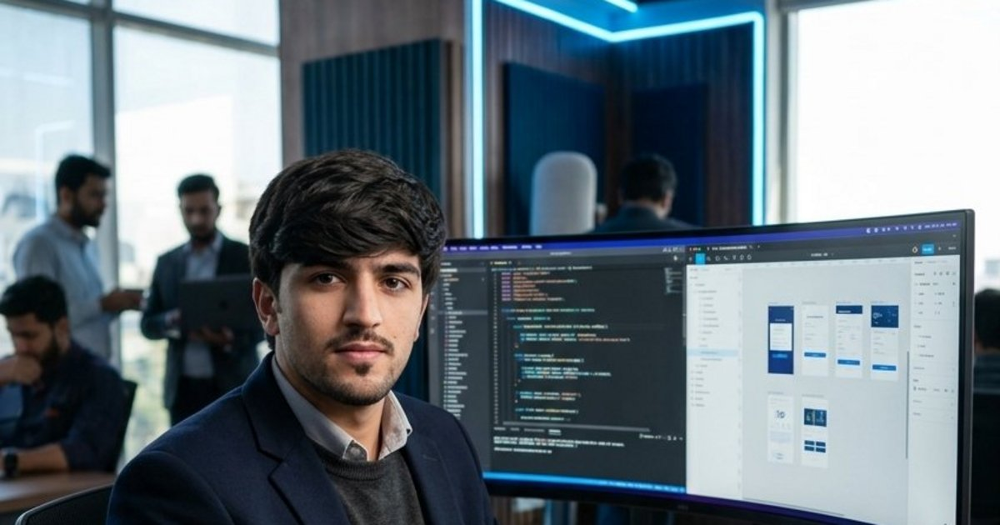

# Portfolio Website — Ahmad Jawid Ahmadi

My personal portfolio and CV on the web: a luxury black-and-gold, bilingual (English / فارسی) site presenting my flagship systems and services.

**Live site:** https://javid-ahmadi-portfolio.vercel.app

## What the site contains
- **Home** — introduction, skills and featured work
- **Projects** — my three flagship systems in full detail, with real dashboard screenshots:
  - 🏥 Hospital PRO — hospital & clinic management
  - 🎓 Institute PRO — institute & course management
  - 🛒 SuperMarket PRO — supermarket POS, inventory & owner reports
- **Services** — management systems, websites & web apps, mobile apps, Pashto/Dari localisation
- **About** — my background (Computer Science, Kabul Polytechnic University)
- **Contact** — WhatsApp and email, one tap from every project

## Design
- Luxury black + gold identity, fully responsive (phone, tablet, desktop)
- Bilingual: English and Persian/Dari with proper RTL
- Real screenshots only — every project is shown with its actual dashboard
- Fast single-page build, deployed on Vercel

## Tech
`HTML` · `CSS` · `JavaScript` · deployed on `Vercel`

## Author
**Ahmad Jawid Ahmadi** — Full Stack Web Developer (React, Django, Flutter), Kabul, working remotely worldwide.
- LinkedIn: https://www.linkedin.com/in/jawid-ahmadi-5a63793ab/
- GitHub: https://github.com/JawidAhmadi77

## Licence
All rights reserved — see [LICENSE](LICENSE). Published for review by recruiters and clients.
